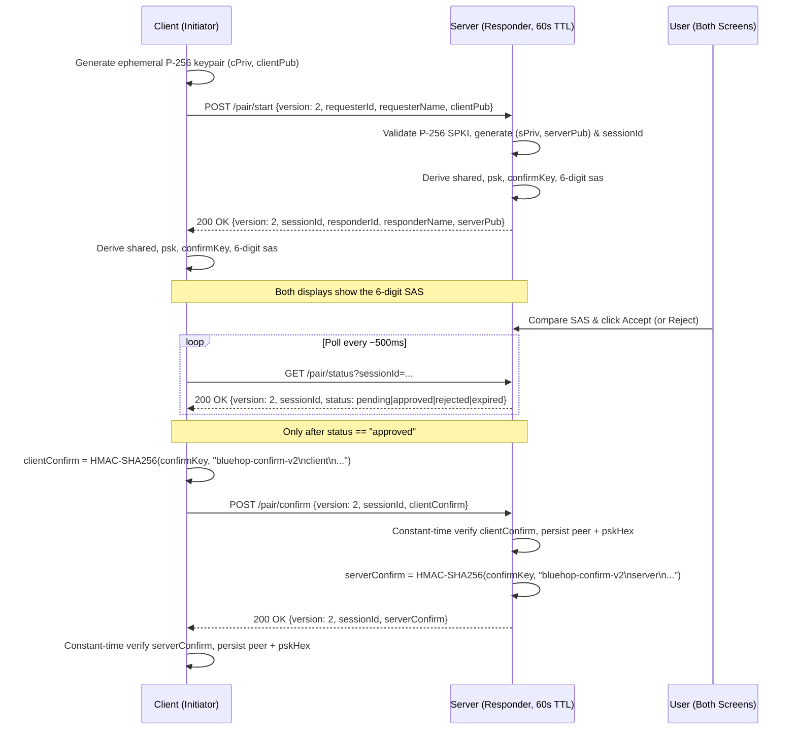

# BlueHop Wire Protocol

BlueHop uses two versioned HTTP/JSON protocols over local Wi-Fi (advertised via mDNS `_bluehop._tcp.` on UDP port `5353`):

- **Pairing Protocol v2 (`PAIRING_PROTOCOL_VERSION = 2`)**: ephemeral ECDH (P-256) + 6-digit Short Authentication String (SAS) + mutual HMAC key confirmation. Listens on TCP port **`8766`** by default (falling back to an ephemeral port if unavailable; the bound port is advertised via mDNS).
- **Release Protocol v1 (`PROTOCOL_VERSION = 1`)**: authenticated `/status` and `/release` requests signed with the paired 32-byte per-peer PSK (`pskHex`). Listens on TCP port **`8765`** by default (falling back to an ephemeral port if unavailable; the bound port is advertised via mDNS).

Deterministic cross-platform test vectors for both protocols live in [`test-vectors.json`](test-vectors.json).

---

## Pairing Protocol (v2)

Pairing establishes a 32-byte per-peer pre-shared key (`psk`) without sending any PIN or secret-derived proof before out-of-band human verification.

### Sequence Diagram



### Public Key Encoding

Ephemeral P-256 (`secp256r1` / `prime256v1`) public keys are encoded as **standard padded base64** of X.509 `SubjectPublicKeyInfo` DER:

- Go: `x509.MarshalPKIXPublicKey(pub)` / `x509.ParsePKIXPublicKey(der)`
- Kotlin / JCA: `publicKey.encoded` / `KeyFactory.getInstance("EC").generatePublic(X509EncodedKeySpec(der))`

Both sides must reject non-P-256 curves.

### Key & SAS Derivation

1. Compute the 32-byte ECDH shared secret (`ECDH_P256(priv, peerPub)`, X coordinate).
2. Build the transcript string:
   ```text
   bluehop-pair-v2\n<sessionId>\n<clientPub>\n<serverPub>
   ```
3. Compute `salt = SHA-256(transcript_utf8)`.
4. Derive keys via HKDF-SHA256 (`ikm = sharedSecret`, `salt = salt`):
   - `psk` (32 bytes, info `"bluehop-pair-v2 psk"`) -> stored as lowercase hex `pskHex`
   - `confirmKey` (32 bytes, info `"bluehop-pair-v2 confirm"`)
   - `sasBytes` (4 bytes, info `"bluehop-pair-v2 sas"`)
5. Compute the 6-digit SAS:
   ```text
   sas = zeroPad6(uint32_be(sasBytes) % 1_000_000)
   ```

### Mutual Key Confirmation

After `GET /pair/status?sessionId=...` returns `"approved"`, both sides compute and verify lowercase hex `HMAC-SHA256` tags using `confirmKey` over:

```text
bluehop-confirm-v2\n<role>\n<sessionId>\n<requesterId>\n<responderId>
```

where `<role>` is `"client"` for `clientConfirm` and `"server"` for `serverConfirm`. Both verifications use constant-time equality (`hmac.Equal` in Go, `MessageDigest.isEqual` in Java/Kotlin). Neither device persists the new peer or `pskHex` until key confirmation succeeds.

### Endpoints & Lifecycle

- `POST /pair/start` -> `200 OK` (`PairStartResponse`), `400` on invalid input/key, `409` if a session is already active or completed. Pending sessions expire after **60 seconds**.
- `GET /pair/status?sessionId=...` -> `200 OK` (`PairStatusResponse` with `status` in `pending`, `approved`, `rejected`, `expired`), `404` if unknown.
- `POST /pair/confirm` -> `200 OK` (`PairConfirmResponse`), `401` on invalid `clientConfirm`, `403` if rejected, `409` if not yet approved or already completed, `410` if expired.

---

## Release Protocol (v1)

Post-pairing endpoints remain unchanged at `PROTOCOL_VERSION = 1`:

- `POST /status` and `POST /release` accept `GrabRequest` signed with lowercase hex `HMAC-SHA256(psk, canonicalPayload)` and return `GrabResponse` signed with the same `psk`.
- Canonical request payload:
  ```text
  v1\nrequest\n<version>\n<deviceAddress>\n<requesterId>\n<timestampEpochSec>\n<nonce>
  ```
- Canonical response payload:
  ```text
  v1\nresponse\n<version>\n<status>\n<deviceAddress>\n<timestampEpochSec>\n<nonce>\n<message>
  ```
- Receivers enforce a `±30s` timestamp skew window and a 60s nonce replay guard.
